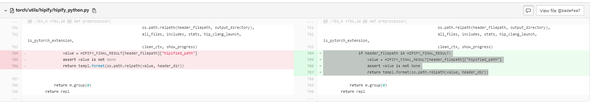

# DeepSpeed

## 安装
DeepSpeed 支持
+ Python 3.8.
+ Python 3.9.
+ Python 3.10.

### 使用pip安装
DeepSpeed whl包下载目录：[https://cancon.hpccube.com:65024/4/main/deepspeed/dtk23.10](https://cancon.hpccube.com:65024/4/main/deepspeed/dtk23.10)
根据对应的pytorch版本和python版本，下载对应deepspeed的whl包

```shell
pip install deepspeed* (下载的deepspeed的whl包)
```

### 使用源码安装
编译之前，需要先安装对应版本python，安装相应的三方包依赖项，并配置DTK环境变量(以Centos7.x为例)。

pytorch whl包下载目录：[https://cancon.hpccube.com:65024/4/main/pytorch/dtk23.10](https://cancon.hpccube.com:65024/4/main/pytorch/dtk23.10)

根据python版本,下载对应pytorch的whl包。如果是基于pytorch1.13，需要注释掉op_builder/builder.py中大概L659： 
```bash
#sources[i] = str(src.relative_to(curr_file))
```
安装依赖项：
```bash
# 安装三方包的源
yum install  epel-release  -y

# 安装相关依赖项
                        
yum install libffi-devel -y
yum -y install openssl openssl-devel
                       
yum install -y libaio-devel
yum install -y libaio

# 配置libiomp5.so库，可以复用系统下现用的so库或者自主安装，也可复用本工程中放置的动态库。指定该动态库的位置。例如export LIBRARY_PATH=/usr/local/lib:$LIBRARY_PATH

# 若python内未包含相关项，需基于上面安装的三方包重新源码编译python，再配置python环境
python3 -m pip install --upgrade pip setuptools
pip3 install wheel -i https://pypi.tuna.tsinghua.edu.cn/simple
pip3 install ninja -i https://pypi.tuna.tsinghua.edu.cn/simple
```

下载DTK并配置环境变量:
```bash
# DTK tar包下载目录：光合社区/资源工具/DCU Toolkit/DTK23.04(https://cancon.hpccube.com:65024/1/main/DTK-23.04)，根据系统选择对应DTK的tar包，并解压至/opt目录。
# 如果使用的是dtk23.04前的版本，可以参考以图片下方式修改torch中的hipify文件
export ROCM_PATH=/opt/dtk-23.04
source /opt/dtk-23.04/env.sh
```



编译deepspeed

```bash
# 下载源码 
git clone -b ds-v0.9.2-rocm http://developer.hpccube.com/codes/aicomponent/deepspeed.git
cd deepspeed
sh requirements/run_pip.sh
DS_BUILD_STRING=.dtk22.10.1.torch1.10 DS_BUILD_RANDOM_LTD=0 DS_BUILD_QUANTIZER=0 DS_BUILD_TRANSFORMER_INFERENCE=0 DS_BUILD_OPS=1 verbose=1 CXX=hipcc CC=hipcc python3 setup.py install bdist_wheel
```

安装deepspeed

```bash
# deepspeed的whl包会在dist文件夹生成
pip3 install ./dist/deepspeed*
```

## Note
+ 若使用 pip install 下载安装过慢，可添加国内源：-i https://pypi.tuna.tsinghua.edu.cn/simple/
+ deepspeed共设置两种版本号查询方式__version__ 和__dcu_version__，分别标识主版本号（与官网版本一致）和基于dcu适配的内部版本号。例如：
```bash
#编译后的whl包示例
[root@26388537c721 deepspeed-v0.9.2-release]# ls dist/
deepspeed-0.9.2+8cfd4af.dtk22.10.1.torch1.10-cp37-cp37m-linux_x86_64.whl
deepspeed-0.9.2+8cfd4af.dtk22.10.1.torch1.10-py3.7-linux-x86_64.egg
#查询deepspeed主版本号示例
[root@26388537c721 deepspeed-v0.9.2-release]# python3 -c "import deepspeed as ds; print(ds.__version__)"
0.9.2
#查询deepspeed基于dcu的内部版本号
[root@26388537c721 deepspeed-v0.9.2-release]# python3 -c "import deepspeed as ds; print(ds.__dcu_version__)"
0.9.2+8cfd4af.dtk22.10.1.torch1.10
```
